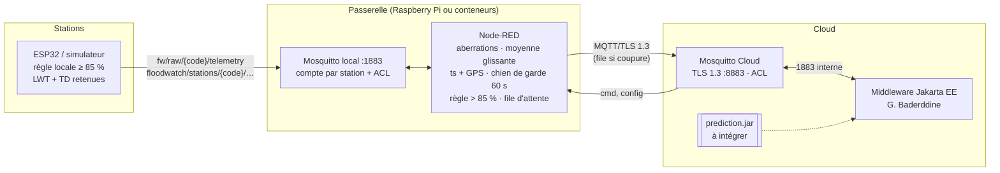

<!--
  Module    : Cloud of Things – FloodWatch (Sup'Com 2026-2027)
  Couche    : back-end & IoT
  Fichier   : README-backend-iot.md
  Équipe    : FloodWatch (Guesmi Baderddine, Ksontini Amine, Kamoun Ahmed)
  Auteur    : Ksontini Amine
  Créé le   : 2026-11-03          Modifié le : 2026-11-03
  Version   : 1.0
-->

# FloodWatch – partie Back-end & IoT

Auteur : **Ksontini Amine**. Cette partie couvre tout ce qui se passe entre le capteur et le
middleware de G. Baderddine : stations (firmware ESP32 et simulateur), passerelle (Mosquitto local et
Node-RED), broker Cloud (TLS 1.3, comptes, ACL) et bibliothèque de prédiction.

| Dossier | Contenu |
|---|---|
| [`firmware/`](firmware/) | ESP32 (PlatformIO / Arduino) : HC-SR04, pluie, servo barrière, LED feu, buzzer, LWT, règle de sécurité locale, **Thing Description** publiée |
| [`simulator/`](simulator/) | stations virtuelles (Python, paquet `fwsim` en couches), TD W3C WoT, 64 tests pytest |
| [`gateway/`](gateway/) | Mosquitto local (comptes + ACL par station), flux Node-RED, registre `stations.json`, installation Raspberry Pi |
| [`deploy/mosquitto/`](deploy/mosquitto/) | broker Cloud : TLS 1.3, ACL au moindre privilège, compte observateur |
| [`deploy/docker-compose.yml`](deploy/docker-compose.yml) | services `mosquitto-local`, `node-red`, `simulator` (profil `iot`), `acl-test` (profil `test`), `firmware` (profil `tools`) |
| [`prediction/`](prediction/) | bibliothèque Java 21 autonome : régression linéaire, temps avant débordement, 38 tests JUnit |
| [`docs/wot/`](docs/wot/) | Thing Descriptions générées des stations de démonstration |



## Contrat MQTT : aligné sur le middleware

Le middleware ([`Topics.java`](backend/api/src/main/java/tn/supcom/cot/api/controllers/managers/Topics.java))
définit le contrat ; ma partie s'y conforme sans rien changer à son code :
`floodwatch/stations/{code}/{telemetry|heartbeat|state|status|ack}` vers le Cloud, `…/cmd` et `…/config`
vers la station, `floodwatch/gateways/{gw}/events` pour la passerelle (détail : [`docs/mqtt-topics.md`](docs/mqtt-topics.md)).

> **Écart avec la demande initiale, tranché en faveur du middleware.**
> Le cahier de ma partie prévoyait `floodwatch/{zone}/{station}/water-level`, `/barrier/cmd`, `/light/cmd`,
> `/siren/cmd`. Le middleware n'accepte que `floodwatch/stations/{code}/{type}` (4 niveaux) et un seul topic
> `/cmd` avec un champ `actuator`. J'ai donc gardé son contrat. La **zone** et le **GPS** sont portés par
> la charge utile (`zone`, `gps`, ajoutés par Node-RED) et par la TD (`location`, `fw:zone`).
> Seul ajout : `floodwatch/stations/{code}/td` (TD retenue). Le middleware ne s'y abonne pas et l'ignore.

Charge utile envoyée au Cloud par la passerelle (champs ajoutés : `rawLevelCm`, `ts`, `gw`, `zone`, `gps`) :

```json
{"rain":0.62,"seq":1793730811,"ts":1793730811512,"gw":"gw-ariana-01","zone":"ariana",
 "gps":{"lat":36.8625,"lon":10.1956},"levelCm":14.37,"rawLevelCm":14.52,"sensorOk":true}
```

## W3C WoT Thing Description

Chaque station publie sa TD (format TD 1.1 du cours), **retenue**, sur `floodwatch/stations/{code}/td`,
à chaque connexion. Il y a une TD par type de station (`UNDERPASS`, `WADI`, `LOW_ROAD`, `FORD`, `OTHER`) :

| Affordance | Topic (formulaire MQTT : `href` = broker + topic, `mqv:topic`, `mqv:controlPacket`, `mqv:qos`, `mqv:retain`) |
|---|---|
| propriétés `waterLevel`, `rain` | `…/telemetry` (champs `levelCm`, `rain`), `observeproperty` |
| propriétés `barrier`, `light` | `…/state` (retenu), `observeproperty` |
| actions `closeBarrier`, `openBarrier`, `setLight`, `siren` | `…/cmd`, `invokeaction` ; entrée = charge `{"id","actuator","value","ts"}` du middleware ; acquittement sur `…/ack` |
| événement `floodAlert` | `…/state` quand `localSafety = true` (fermeture autonome) |
| événement `offline` | `…/status` (LWT retenu `online` / `offline`) |

- Source unique : la fabrique [`fwsim/wot.py`](simulator/fwsim/wot.py) (patron Factory).
  [`tools/export_td.py`](simulator/tools/export_td.py) en génère le gabarit embarqué dans l'ESP32
  ([`td_template.h`](firmware/include/td_template.h)) et les exemples [`docs/wot/`](docs/wot/).
- Validation : `validate_thing_description()` renvoie `{"valid", "errors"}` comme `validateThingDescription`
  du cours. Elle reprend ses 4 contrôles de base, auxquels s'ajoutent les contraintes du modèle
  `things.model.mjs` (`id` URN, énumérations `op`, types JSON Schema, schémas de sécurité, `location`
  GeoJSON), les règles MQTT et le contrat FloodWatch.
  Tests : [`tests/test_wot.py`](simulator/tests/test_wot.py) (chaque type, gabarit du firmware rempli,
  18 cas invalides, exemple du cours, fichiers générés à jour).
- Le middleware expose aussi une TD (REST, `GET /api/stations/{id}/td`) avec le même `id`
  (`urn:floodwatch:station:{code}`) : celle de la station décrit l'accès MQTT direct, celle de l'API l'accès REST.

## Démarrage (Windows 11, PowerShell, Docker Desktop)

```powershell
cd deploy
Copy-Item .env.example .env        # puis remplacer TOUS les change-me (ou deploy/scripts/install-vm.sh sur la VM)
# certificats TLS (AC privée + serveur, SAN localhost et mosquitto) – script bash exécuté dans un conteneur :
docker run --rm -v "${PWD}:/deploy" -w /deploy alpine:3.20 sh -c "apk add -q bash openssl && bash scripts/gen-certs.sh localhost"
docker compose --profile iot up -d --build     # middleware + broker Cloud + passerelle + 2 stations simulées
docker compose ps                              # node-red, simulator : (healthy)
```

| Service | Accès |
|---|---|
| Node-RED (éditeur) | <http://localhost:1880> – `admin` / `NODE_RED_ADMIN_PASSWORD` |
| Santé passerelle | <http://localhost:1880/health> → `UP`, `DEGRADED` (Cloud coupé) ou `DOWN` |
| Broker local | `localhost:1883` – compte `diag` (lecture seule) pour MQTT Explorer |
| Broker Cloud | `localhost:8883` TLS 1.3, AC `deploy/certs/ca.crt` – compte `observer` (lecture seule) |
| PWA / API | <https://localhost/>, <https://localhost/api/health> (middleware) |

`docker compose up` sans profil démarre exactement les services du middleware, comme avant.

## Tests

| Quoi | Commande | Résultat |
|---|---|---|
| Prédiction (JUnit 5) | `cd prediction; .\mvnw.cmd verify` | 38 tests |
| Simulateur + TD (pytest) | `cd simulator; py -m venv .venv; .venv\Scripts\pip install -r requirements-dev.txt; .venv\Scripts\python -m pytest` | 64 tests |
| Comptes, ACL, TLS 1.3 | `cd deploy; docker compose --profile test run --rm --build acl-test` | 25 cas (local + Cloud), dont refus d'une poignée de main TLS 1.2 (openssl) |
| Firmware ESP32 | `cd deploy; docker compose --profile tools run --rm firmware` | compilation PlatformIO |
| Fonctions du flux Node-RED | `node --test gateway/node-red/test/flows.test.mjs` | 11 tests (filtrage, aberrations, règle 85 %, file d'attente, chien de garde, santé) |

## Scénario de démonstration (≈ 5 min, `SIM_SPEED=3`)

Ouvrir MQTT Explorer sur `localhost:1883` (compte `diag`), l'éditeur Node-RED et la PWA Pilotage.

1. **Démarrage** : `docker compose --profile iot up -d --build`. Les stations publient `status=online`,
   leur **TD** et leur état (tous retenus) : `floodwatch/stations/underpass-01/td` est visible dans MQTT Explorer.
2. **Filtrage** : nœud « Filtrer et enrichir ». La télémétrie brute (`fw/raw/…`) ressort lissée (moyenne
   sur 5), avec `ts` et `gps`. Les échos parasites du simulateur (3 %) sont rejetés : statut
   « aberration rejetée » et ligne `outlier_rejected` dans `docker compose logs node-red`.
3. **Montée des eaux** (scénario `storm`) : vert → jaune (pluie) → orange → rouge dans la PWA
   (moteur d'alerte du middleware).
4. **Sécurité locale** : à 85 %, la station ferme seule sa barrière (`state.localSafety=true`, événement
   WoT `floodAlert`). Au-delà de 85 % du niveau filtré, la passerelle envoie aussi `CLOSE` + `RED`
   (`local_safety` dans les événements de la passerelle).
5. **Coupure du Cloud** : `docker compose stop mosquitto`. `/health` passe à `DEGRADED` et le nœud
   « File d'attente Cloud » compte les messages en attente. Les stations restent protégées par la règle locale.
   `docker compose start mosquitto` : la file est renvoyée dans l'ordre (`queue_flush` dans les logs).
6. **Station muette** : `SIM_OFFLINE_AFTER=60 docker compose --profile iot up -d simulator`. La 1re station
   se tait : LWT `offline` retenu (événement WoT `offline`), puis `station_mute` de la passerelle après 60 s
   et alerte « hors ligne » du middleware (45 s).
7. **Verrou de sécurité** : depuis la PWA Pilotage, demander l'ouverture de la barrière au-dessus du seuil
   rouge. La station répond `ack.ok=false` (« verrouillage sécurité »).
8. **Sécurité des brokers** : `docker compose --profile test run --rm --build acl-test`.

## Inspiré du cours

Le professeur a demandé d'appliquer le projet de référence `WoT-NodeJS` à notre projet. Voici ce que
j'en ai repris :

| Élément du cours | Application dans ma partie |
|---|---|
| `things/models/things.model.mjs` : modèle Thing TD 1.1 (`@context`, `id` URN, `@type`, `securityDefinitions`, `forms` avec `mqv:topic` / `mqv:controlPacket` / `mqv:qos` / `mqv:retain`, `location` GeoJSON) | fabrique de TD [`fwsim/wot.py`](simulator/fwsim/wot.py) : mêmes champs, une TD par type de station, `@type` `Thing`/`Sensor`/`Actuator`, `location` `[lon, lat]` |
| `docs/README.md` : exemple MQTT (`href` = `mqtt://hôte:port/topic`, `op` `subscribeevent`) | même forme de `href` ; l'exemple du cours est un cas de test du validateur |
| `wot.service.mjs` : `validateThingDescription` → `{valid, errors}` | `validate_thing_description()` : même résultat et mêmes contrôles de base, étendus |
| `mqtt.service.mjs` : `subscribe(motif, callback, qos, nl)`, `unsubscribe`, `publish(topic, payload, qos, retain)`, répartiteur par règles | [`fwsim/mqtt_service.py`](simulator/fwsim/mqtt_service.py) : même API en Python, MQTT v5 pour `nl`, table de règles par motif |
| `main/config/env.config.mjs` + bonne pratique n° 1 (zod) : configuration centralisée validée au démarrage | [`fwsim/config.py`](simulator/fwsim/config.py), [`settings.js`](gateway/node-red/settings.js), [`docker-entrypoint.sh`](gateway/mosquitto/docker-entrypoint.sh) : toutes les erreurs listées, arrêt immédiat |
| bonne pratique n° 7 : secrets en variables d'environnement, TLS 1.3 uniquement | mots de passe MQTT / Node-RED uniquement dans `deploy/.env` (ignoré par git), `tls_version tlsv1.3` sur le broker Cloud |
| n° 2 et 3 : modules et couches | simulateur : `config` → `mqtt_service` (infrastructure) → `station` (service) → `wot` / `scenarios` (modèle) ; passerelle : flux Node-RED en 6 blocs |
| n° 4 : tests avant commit (TDD, XP) | 38 JUnit + 64 pytest + 11 tests Node-RED + 25 cas ACL, exécutés avant chaque commit |
| n° 5 : patrons | **Strategy** (scénarios de pluie, `OverflowPredictor` côté middleware), **Factory** (TD par type, client MQTT), **Observer** (`on("connect")`, nœud Statut Node-RED), **Retry** (reconnexion exponentielle 1 → 30 s, file d'attente store-and-forward) |
| n° 9 : journaux structurés | `LOG_FORMAT=json` (simulateur), événements JSON dans Node-RED (`outlier_rejected`, `local_safety`, `queue_flush`…) |
| n° 10 : contrôle de santé | `GET /health` (Node-RED, simulateur) + `HEALTHCHECK` Docker |

Aucune clé ni aucun certificat du cours (`jwt-key`, `*.pem`, `dhparam.pem`) n'a été copié. Nos certificats
sont générés localement dans `deploy/certs/` (ignoré par git).

## Points à valider avec le middleware

- **Prédiction** : le middleware garde son `LinearRegressionPredictor` (fenêtre de 2 min, sans garde de
  niveau). L'intégration de `prediction/` se fait par un adaptateur de 10 lignes (cf.
  [`prediction/README.md`](prediction/README.md)) : elle est laissée à G. Baderddine.
- **Horodatage** : le middleware date les mesures à la réception (`Instant.now()`). Après une coupure du
  Cloud, les mesures renvoyées par la file arrivent groupées. Le champ `ts` de la passerelle donne
  l'instant réel ; à utiliser si l'on veut un historique exact.
- **Acquittements des commandes de la passerelle** : la règle 85 % envoie des commandes avec un UUID
  inconnu du middleware. Leurs `ack` sont ignorés sans erreur (`CommandManager.onAck`).
- **Compte unique `gateway` sur le Cloud** : toutes les passerelles partagent ce compte (contrat existant).
  Une ACL par zone demanderait un compte par passerelle.
