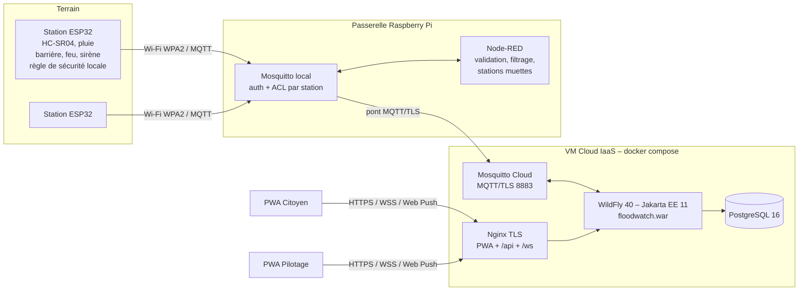

# FloodWatch – Alerte précoce des crues et des routes inondées

Projet du module **Cloud of Things** – Sup'Com 2026-2027.
Équipe : **Guesmi Baderddine** (middleware) · **Ksontini Amine** (back-end & IoT) · **Kamoun Ahmed** (front-end PWA).

FloodWatch surveille les points bas de la voirie (passages souterrains, gués d'oued). Des stations
ESP32 mesurent le niveau d'eau et la pluie. Une passerelle Raspberry Pi (Mosquitto + Node-RED)
relaie les données en MQTT/TLS vers le Cloud. Une API **Jakarta EE 11** calcule le niveau
d'alerte et le temps avant débordement, puis ferme automatiquement les barrières. Elle prévient
les citoyens et les opérateurs via deux **PWA** (Web Push). Chaque station ferme aussi sa barrière
**localement** au seuil rouge, même sans Cloud.



## Contenu du dépôt

| Dossier | Contenu | Responsable |
|---|---|---|
| `backend/` | API Jakarta EE 11 (Maven : `core`, `iam`, `api`) → `floodwatch.war`, Dockerfile WildFly 40 | Baderddine (middleware), Amine (persistance, REST, IAM) |
| `firmware/` | Firmware ESP32 (PlatformIO) avec règle de sécurité locale | Amine |
| `gateway/` | Mosquitto local + pont TLS, flux Node-RED, script d'installation Raspberry Pi | Amine |
| `simulator/` | Simulateur Python de stations (démos sans matériel) | Amine |
| `pwa/` | `citoyen/`, `pilotage/`, `shared/` (+ mode démonstration hors serveur) | Ahmed |
| `deploy/` | `docker-compose.yml`, Nginx, Mosquitto Cloud, certificats, scripts VM | Amine |
| `postman/` | Collection de tests REST (30 requêtes, 46 assertions) + environnements | Amine |
| `docs/` | Architecture, topics MQTT, OpenAPI, déploiement, manuels, corrections du code de départ | tous |

## Démarrage rapide (VM ou poste avec Docker)

```bash
git clone https://github.com/baderddine725/FloodWatch_cot.git && cd FloodWatch_cot/deploy
cp .env.example .env            # puis changer TOUS les secrets
./scripts/gen-certs.sh localhost   # ou le nom DNS de la VM
docker compose up -d --build
```

- PWA Citoyen : `https://localhost/` · PWA Pilotage : `https://localhost/pilotage/`
  (comptes `admin` / `operator`, mots de passe de `.env`)
- API : `https://localhost/api/health` · OpenAPI : `https://localhost/api/openapi`
- Broker MQTT/TLS : `localhost:8883` (utilisateur `gateway`)

Pour simuler deux stations, sans matériel :

```bash
pip install -r simulator/requirements.txt
python3 simulator/floodwatch_sim.py --host localhost --port 8883 --tls --cafile deploy/certs/ca.crt \
        --username gateway --password <MQTT_GATEWAY_PASSWORD> --scenario storm --speed 3 -v
```

Pour présenter les PWA sans aucun serveur : `?demo=1` (backend simulé dans le navigateur).
Déploiement complet, passerelle et firmware : [`docs/deployment.md`](docs/deployment.md).

## Scénario de démonstration (≈ 3 min, `--speed 3`)

1. **Vert** : niveau bas, mesure toutes les 30 s.
2. **Jaune** : la pluie est détectée. Le Cloud passe la station en surveillance renforcée (5 s).
3. **Orange** : montée rapide (> 3 cm/min). Le feu passe à l'orange.
4. **Rouge** : débordement prévu en moins de 10 min, avant même 85 %. Barrière fermée, feu rouge, sirène,
   notification push. Le délai détection → fermeture apparaît dans les KPI (< 1 s mesuré).
5. Décrue : rouge maintenu jusqu'à 60 s sous le seuil orange, puis réouverture automatique.
6. `--offline-after 60` : station muette, alerte « station hors ligne » en moins de 45 s.
7. Mode dégradé : couper le broker Cloud. La station ferme quand même sa barrière (règle locale).

## Couverture du cahier des charges

| Priorité | Fonctionnalité | État |
|---|---|---|
| Indispensable | Mesure + publication MQTT, message de vie 15 s | ✅ firmware + simulateur |
| | Ingestion API, stockage PostgreSQL | ✅ |
| | Niveaux d'alerte (Table 1), seuils par station | ✅ moteur testé (23 tests) |
| | Commande barrière / feu / sirène + acquittement | ✅ automatique et manuelle |
| | Règle de sécurité locale (fermeture autonome) | ✅ firmware + simulateur, verrou d'ouverture |
| | Tableau de bord temps réel (WebSocket) | ✅ PWA Pilotage |
| | Notifications (Web Push VAPID, sans dépendance) | ✅ vérifié contre la bibliothèque de référence |
| | Authentification (JWT, rôles citoyen/opérateur/admin) | ✅ |
| Importante | Carte interactive | ✅ Leaflet / OpenStreetMap |
| | KPI (disponibilité, alertes, délai et durée de fermeture) | ✅ |
| | Historique, courbes | ✅ |
| | Temps avant débordement (régression + filtre médian) | ✅ |
| | Détection station hors ligne (≤ 45 s + LWT MQTT) | ✅ cloud et passerelle |
| Souhaitable | Analytique comparative entre stations | ✅ partielle (KPI par station) |
| | Mode hors connexion avancé | ✅ consultation hors ligne (PWA Citoyen) |
| | Prédiction avec API météo, escalade hiérarchique, magasins d'applications | ⏳ reporté (cf. § 5.1) |

**Patrons de conception** : Observer (événements CDI → WebSocket, Web Push), Command (commandes d'actionneurs),
Strategy (prédicteur, politique d'actionnement), Chain of Responsibility (règles d'alerte),
Decorator (filtre médian du prédicteur), Repository, DTO, Singleton (client MQTT).
**Modèles IoT** : Thing (station), Sensor/Actuator, Payload JSON, BrokerClient (`MqttManager`),
**W3C WoT Thing Description** (`GET /api/stations/{id}/td`).

## Tests

- `cd backend && mvn test` : tests unitaires (moteur d'alerte, prédiction, hystérésis, UUIDv7, JWT, PBKDF2).
- `newman run postman/FloodWatch.postman_collection.json -e postman/local.postman_environment.json`
- Tests de bout en bout réalisés pendant le développement : simulateur → pont TLS → WildFly 40 → PostgreSQL → PWA
  (230/230 assertions REST sous ingestion concurrente).

Voir aussi : [architecture](docs/architecture.md) · [topics MQTT](docs/mqtt-topics.md) ·
[corrections du code de départ](docs/corrections-code-depart.md) · [guide citoyen](docs/guide-citoyen.md) ·
[guide pilotage](docs/guide-pilotage.md) · [répartition du travail](docs/repartition.md)
