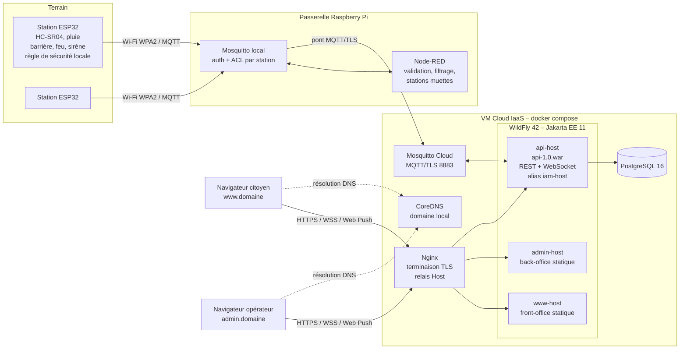

# FloodWatch – Alerte précoce des crues et des routes inondées

Projet du module **Cloud of Things** – Sup'Com 2026-2027.
Équipe : **Guesmi Baderddine** (middleware) · **Ksontini Amine** (back-end & IoT) · **Kamoun Ahmed** (front-end PWA).

FloodWatch surveille les points bas de la voirie (passages souterrains, gués d'oued). Des stations
ESP32 mesurent le niveau d'eau et la pluie. Une passerelle Raspberry Pi (Mosquitto + Node-RED)
relaie les données en MQTT/TLS vers le Cloud. Un **middleware Jakarta EE 11** (WildFly 42) calcule
le niveau d'alerte et le temps avant débordement, puis ferme automatiquement les barrières. Il
prévient les citoyens et les opérateurs via deux **PWA** (Web Push) qu'il sert lui-même, chacune
sur son propre nom DNS. Chaque station ferme aussi sa barrière
**localement** au seuil rouge, même sans Cloud.



## Contenu du dépôt

| Dossier | Contenu | Responsable |
|---|---|---|
| `middleware/` | Middleware Jakarta EE 11 (Maven : `core`, `iam`, `api`) → `api-1.0.war`, Dockerfile WildFly 42 et configuration Undertow (`wildfly/`) | Baderddine (middleware), Amine (persistance, REST, IAM) |
| `firmware/` | Firmware ESP32 (PlatformIO) avec règle de sécurité locale | Amine |
| `backend/gateway/` | Mosquitto local + pont TLS, flux Node-RED, script d'installation Raspberry Pi | Amine |
| `backend/simulator/` | Simulateur Python de stations (démos sans matériel) | Amine |
| `frontend/` | `frontoffice/` (espace citoyen), `backoffice/` (espace pilotage), `shared/` (code commun aux deux) + mode démonstration hors serveur | Ahmed |
| `backend/deploy/` | `docker-compose.yml`, Nginx (TLS), CoreDNS (domaine local), Mosquitto Cloud, certificats, scripts VM | Amine |
| `backend/postman/` | Collection de tests REST (30 requêtes, 46 assertions) + environnements | Amine |
| `docs/` | Architecture, intelligence distribuée (`ml-architecture.md`), topics MQTT, OpenAPI, déploiement, manuels, corrections du code de départ | tous |

## Démarrage rapide (VM ou poste avec Docker)

```bash
git clone https://github.com/baderddine725/FloodWatch_cot.git && cd FloodWatch_cot/backend/deploy
cp .env.example .env               # puis changer TOUS les secrets
./scripts/gen-certs.sh floodwatch.local 127.0.0.1    # ou le domaine et l'IP de la VM
docker compose up -d --build
sudo ./scripts/dns-hosts.sh floodwatch.local 127.0.0.1   # Windows : .\scripts\dns-hosts.ps1
```

Quatre noms DNS, un seul serveur d'applications : WildFly sert les deux front-ends
(hôtes virtuels Undertow) **et** le middleware ; Nginx ne fait que terminer le TLS.

| Adresse | Rôle | Hôte virtuel WildFly |
|---|---|---|
| `https://www.floodwatch.local/` | front-office, espace citoyen (public) | `www-host` |
| `https://admin.floodwatch.local/` | back-office, espace pilotage (`admin` / `operator`) | `admin-host` |
| `https://api.floodwatch.local/api/health` | API REST, WebSocket, Thing Descriptions | `api-host` |
| `https://iam.floodwatch.local/api/auth/login` | authentification (seules les routes `/api/auth/**` répondent) | `api-host` + filtre `iam-scope` |

- Broker MQTT/TLS : `mqtt.floodwatch.local:8883` (utilisateur `gateway`)
- Résolution des noms : le service `dns` (CoreDNS) répond pour tout le domaine ;
  `scripts/dns-hosts.sh` / `.ps1` est la solution de repli sur un poste de travail.

Pour simuler deux stations, sans matériel :

```bash
pip install -r backend/simulator/requirements.txt
python3 backend/simulator/floodwatch_sim.py --host localhost --port 8883 --tls --cafile backend/deploy/certs/ca.crt \
        --username gateway --password <MQTT_GATEWAY_PASSWORD> --scenario storm --speed 3 -v
```

Pour présenter les PWA sans aucun serveur : `?demo=1` (backend simulé dans le navigateur).
Déploiement complet, passerelle et firmware : [`docs/deployment.md`](docs/deployment.md).

## Scénario de démonstration (≈ 3 min, `--speed 3`)

1. **Vert** : niveau bas, mesure toutes les 30 s.
2. **Jaune** : la pluie est détectée. Le Cloud passe la station en surveillance renforcée (5 s).
3. **Orange** : montée rapide (> 3 cm/min). Le feu passe à l'orange.
4. **Rouge** : débordement prévu en moins de 10 min, avant même 85 %. Barrière fermée, feu rouge, sirène,
   notification push. Le délai détection → fermeture apparaît dans les KPI (< 1 s mesuré).
5. Décrue : rouge maintenu jusqu'à 60 s sous le seuil orange, puis réouverture automatique.
6. `--offline-after 60` : station muette, alerte « station hors ligne » en moins de 45 s.
7. Mode dégradé : couper le broker Cloud. La station ferme quand même sa barrière (règle locale).

Avec la passerelle (pile Docker complète), le simulateur tourne en **temps réel** (`SIM_SPEED=1`) sur
le scénario `season` : orages de zone répétés toutes les 15 min sur les trois stations couplées
(`upstream-01` → `wadi-01` → `underpass-01`). Le fog a besoin du temps physique (temps de parcours,
calibration) : pré-alertes de propagation dès le premier orage, calibration de `upstream-01` après
5 min, des stations aval après le deuxième épisode pluvieux (≈ 35 min), puis prévisions
`reservoir-calibrated` sur `/api/intelligence`. Voir [`docs/ml-architecture.md`](docs/ml-architecture.md).

**Cycle MLOps** (`--profile ml`) : le service `trainer` apprend un modèle de prévision sur la
télémétrie de PostgreSQL (instantanés versionnés), le soumet à un critère d'acceptation, le publie
comme challenger évalué en ombre sur les mesures réelles, le promeut champion s'il bat la méthode en
place, surveille la dérive et réapprend ; MLflow trace tout (`http://127.0.0.1:5000`). État :
`GET /api/kpi/models`. Détails : § 3.8 de [`docs/ml-architecture.md`](docs/ml-architecture.md).

**En ligne, gratuitement** : Oracle Cloud « Always Free » (VM ARM) + nom DuckDNS + Let's Encrypt,
en une commande (`backend/deploy/scripts/deploy-cloud.sh`) — § 0 de [`docs/deployment.md`](docs/deployment.md).

## Couverture du cahier des charges

| Priorité | Fonctionnalité | État |
|---|---|---|
| Indispensable | Mesure + publication MQTT, message de vie 15 s | ✅ firmware + simulateur |
| | Ingestion API, stockage PostgreSQL | ✅ |
| | Niveaux d'alerte (Table 1), seuils par station | ✅ moteur testé (23 tests) |
| | Commande barrière / feu / sirène + acquittement | ✅ automatique et manuelle |
| | Règle de sécurité locale (fermeture autonome) | ✅ firmware + simulateur, verrou d'ouverture |
| | Tableau de bord temps réel (WebSocket) | ✅ PWA Pilotage |
| | Notifications (Web Push VAPID, sans dépendance) | ✅ vérifié contre la bibliothèque de référence |
| | Authentification (JWT, rôles citoyen/opérateur/admin) | ✅ |
| Importante | Carte interactive | ✅ Leaflet / OpenStreetMap |
| | KPI (disponibilité, alertes, délai et durée de fermeture) | ✅ |
| | Historique, courbes | ✅ |
| | Temps avant débordement (régression + filtre médian) | ✅ |
| | Détection station hors ligne (≤ 45 s + LWT MQTT) | ✅ cloud et passerelle |
| Souhaitable | Analytique comparative entre stations | ✅ partielle (KPI par station) |
| | Mode hors connexion avancé | ✅ consultation hors ligne (PWA Citoyen) |
| | Prédiction avec API météo, escalade hiérarchique, magasins d'applications | ⏳ reporté (cf. § 5.1) |

**Patrons de conception** : Observer (événements CDI → WebSocket, Web Push), Command (commandes d'actionneurs),
Strategy (prédicteur, politique d'actionnement), Chain of Responsibility (règles d'alerte),
Decorator (filtre médian du prédicteur), Repository, DTO, Singleton (client MQTT).
**Modèles IoT** : Thing (station), Sensor/Actuator, Payload JSON, BrokerClient (`MqttManager`),
**W3C WoT Thing Description** (`GET /api/stations/{id}/td`).

## Tests

- `cd middleware && mvn test` : tests unitaires (moteur d'alerte, prédiction, hystérésis, UUIDv7, JWT, PBKDF2).
- `newman run backend/postman/FloodWatch.postman_collection.json -e backend/postman/local.postman_environment.json`
- Tests de bout en bout réalisés pendant le développement : simulateur → pont TLS → WildFly → PostgreSQL → PWA
  (230/230 assertions REST sous ingestion concurrente).

Voir aussi : [architecture](docs/architecture.md) · [topics MQTT](docs/mqtt-topics.md) ·
[corrections du code de départ](docs/corrections-code-depart.md) · [guide citoyen](docs/guide-citoyen.md) ·
[guide pilotage](docs/guide-pilotage.md) · [répartition du travail](docs/repartition.md) ·
[partie Back-end & IoT : passerelle, brokers, TD WoT, prédiction](README-backend-iot.md)
