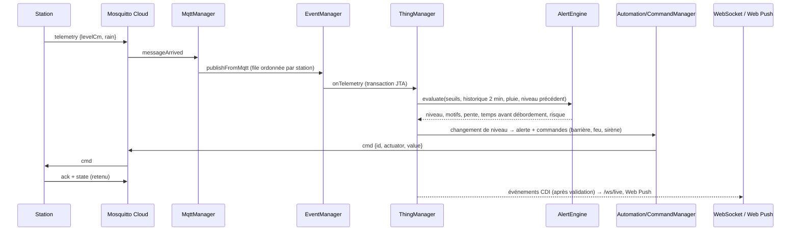

# Architecture technique

## Composants (diagramme de déploiement)

| Nœud | Logiciel | Rôle |
|---|---|---|
| Station ESP32 (×N) | `firmware/` (Arduino, PubSubClient, ArduinoJson) | mesure, actionneurs, règle de sécurité locale, LWT |
| Passerelle Raspberry Pi | Mosquitto 2 + Node-RED 4 (`gateway/`) | broker local authentifié, validation/filtrage, détection de station muette, pont TLS |
| VM Cloud IaaS | Docker Compose (`deploy/`) | Mosquitto Cloud (8883), WildFly 40 (Jakarta EE 11), PostgreSQL 16, Nginx TLS |
| Smartphone / navigateur | PWA Citoyen, PWA Pilotage | HTTPS (REST), WSS (temps réel), Web Push |

## Découpage de l'API (`backend/`)

```
core   UUIDPKEntity, RootEntity, UUIDv7, ETagSupport, AbstractRepository
iam    Identity, Role (masque de bits), PasswordHasher (PBKDF2), TokenService (JWT HS256)
api
 ├─ boundaries        REST (Auth, Station, Alert, Kpi, User, Push, Health), LiveEndpoint (WebSocket),
 │                    AuthenticationFilter (@RolesAllowed), CorsFilter, ErrorMappers, ThingDescriptions (WoT)
 ├─ controllers
 │   ├─ alerting      AlertEngine, AlertRuleHandler + AlertRules (chaîne), OverflowPredictor,
 │   │                LinearRegressionPredictor, MedianFilterPredictor (décorateur), RiskIndex
 │   ├─ commands      StationCommand (scellée) : Barrier/Light/Siren/SamplingCommand, CommandFactory,
 │   │                ActuationPolicy / DefaultActuationPolicy
 │   ├─ managers      MqttManager (BrokerClient), EventManager (bus entrant), ThingManager (jumeau numérique),
 │   │                AlertManager, AutomationManager, CommandManager, StationWatchdog (@Schedule 5 s),
 │   │                WebSocketManager, KpiManager, StationManager, SeedManager, Retry, Topics
 │   ├─ push          WebPushSender (RFC 8291/8292, JDK seul), PushManager, PushStore
 │   └─ repositories  dépôts JPA
 ├─ entities          Station (+StationThresholds), Measurement, Alert, ActuatorCommand, PushSubscription, AppSetting
 └─ dto               records exposés par l'API et diffusés en temps réel
```

## Traitement d'une mesure



## Moteur d'alerte (Table 1)

Chaîne de responsabilité, chaque règle pouvant élever le niveau :
1. `LevelThresholdRule` : ≥ 30 % jaune, ≥ 60 % orange, ≥ 85 % rouge (du niveau critique) ;
2. `RainRule` : pluie ≥ seuil, jaune ;
3. `RapidRiseRule` : pente ≥ 3 cm/min, orange ;
4. `OverflowForecastRule` : débordement prévu ≤ 10 min (si niveau ≥ jaune), rouge ;
5. `RedHysteresisRule` : sortie du rouge seulement après `reopenDelaySec` sous le seuil orange.

Prédiction (Strategy) : régression linéaire par moindres carrés sur 2 min (≥ 4 mesures sur ≥ 15 s),
décorée d'un rejet des valeurs aberrantes par médiane locale (échos du HC-SR04).
Erreur mesurée sur une montée linéaire : < 20 % (objectif du § 2.5), voir `AlertEngineTest`.

## Persistance (PostgreSQL)

`stations`, `measurements` (index station+date), `alerts` (horodatages de fermeture/réouverture pour les KPI),
`commands` (audit et acquittement), `identities`, `push_subscriptions`, `app_settings` (clés VAPID).
Schéma créé/mis à jour par Hibernate 7 (`hbm2ddl=update`). Identifiants UUIDv7, verrouillage optimiste
(`@Version`) exposé en ETag (`If-Match` / `If-None-Match`).

## Sécurité

- JWT HS256 (secret `JWT_SECRET`), rôles `CITIZEN`, `OPERATOR`, `ADMIN` vérifiés par filtre JAX-RS ;
  mots de passe PBKDF2-HMAC-SHA256 (210 000 itérations).
- TLS : Nginx (HTTPS/WSS), Mosquitto 8883 ; broker local en WPA2 avec ACL par station.
- Web Push : chiffrement aes128gcm, VAPID ES256 (clés générées au premier démarrage, stockées en base).
