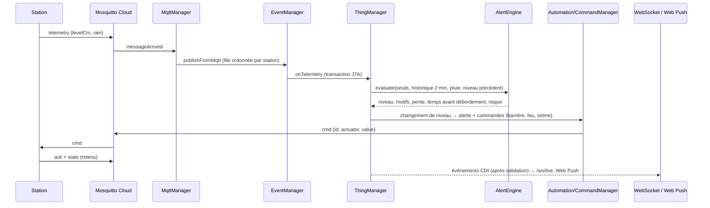

# Architecture technique

## Composants (diagramme de déploiement)

| Nœud | Logiciel | Rôle |
|---|---|---|
| Station ESP32 (×N) | `firmware/` (Arduino, PubSubClient, ArduinoJson) | mesure, actionneurs, règle de sécurité locale, LWT |
| Passerelle Raspberry Pi | Mosquitto 2 + Node-RED 4 (`backend/gateway/`) | broker local authentifié, validation/filtrage, détection de station muette, pont TLS |
| VM Cloud IaaS | Docker Compose (`backend/deploy/`) | Mosquitto Cloud (8883), WildFly 42 (Jakarta EE 11 : middleware **et** front-ends), PostgreSQL 16, Nginx (terminaison TLS), CoreDNS (domaine local) |
| Smartphone / navigateur | front-office (`www.<domaine>`), back-office (`admin.<domaine>`) | HTTPS (REST sur `api.<domaine>`), WSS (temps réel), Web Push |

## Découpage du middleware (`middleware/`)

```
core   UUIDPKEntity, RootEntity, UUIDv7, ETagSupport, AbstractRepository
iam    Identity, Role (masque de bits), PasswordHasher (PBKDF2), TokenService (JWT HS256)
api
 ├─ boundaries        REST (Auth, Station, Alert, Kpi, User, Push, Health), LiveEndpoint (WebSocket),
 │                    AuthenticationFilter (@RolesAllowed), CorsFilter, ErrorMappers, ThingDescriptions (WoT)
 ├─ controllers
 │   ├─ alerting      AlertEngine, AlertRuleHandler + AlertRules (chaîne), OverflowPredictor,
 │   │                LinearRegressionPredictor, MedianFilterPredictor (décorateur), RiskIndex
 │   ├─ commands      StationCommand (scellée) : Barrier/Light/Siren/SamplingCommand, CommandFactory,
 │   │                ActuationPolicy / DefaultActuationPolicy
 │   ├─ managers      MqttManager (BrokerClient), EventManager (bus entrant), ThingManager (jumeau numérique),
 │   │                AlertManager, AutomationManager, CommandManager, StationWatchdog (@Schedule 5 s),
 │   │                WebSocketManager, KpiManager, StationManager, SeedManager, Retry, Topics
 │   ├─ push          WebPushSender (RFC 8291/8292, JDK seul), PushManager, PushStore
 │   └─ repositories  dépôts JPA
 ├─ entities          Station (+StationThresholds), Measurement, Alert, ActuatorCommand, PushSubscription, AppSetting
 └─ dto               records exposés par l'API et diffusés en temps réel
```

## Traitement d'une mesure



## Moteur d'alerte (Table 1)

Chaîne de responsabilité, chaque règle pouvant élever le niveau :
1. `LevelThresholdRule` : ≥ 30 % jaune, ≥ 60 % orange, ≥ 85 % rouge (du niveau critique) ;
2. `RainRule` : pluie ≥ seuil, jaune ;
3. `RapidRiseRule` : pente ≥ 3 cm/min, orange ;
4. `OverflowForecastRule` : débordement prévu ≤ 10 min (si niveau ≥ jaune), rouge ;
5. `RedHysteresisRule` : sortie du rouge seulement après `reopenDelaySec` sous le seuil orange.

Prédiction (Strategy) : régression linéaire par moindres carrés sur 2 min (≥ 4 mesures sur ≥ 15 s),
décorée d'un rejet des valeurs aberrantes par médiane locale (échos du HC-SR04).
Erreur mesurée sur une montée linéaire : < 20 % (objectif du § 2.5), voir `AlertEngineTest`.

## Persistance (PostgreSQL)

`stations`, `measurements` (index station+date), `alerts` (horodatages de fermeture/réouverture pour les KPI),
`commands` (audit et acquittement), `identities`, `push_subscriptions`, `app_settings` (clés VAPID),
`prediction_records` (ce que le modèle annonçait, puis ce qui a été mesuré) et `sensor_diagnostics`
(chaque lecture du capteur avec son verdict, y compris celles que la passerelle écarte) — voir
[`ml-architecture.md`](ml-architecture.md).
Schéma créé/mis à jour par Hibernate 7 (`hbm2ddl=update`). Identifiants UUIDv7, verrouillage optimiste
(`@Version`) exposé en ETag (`If-Match` / `If-None-Match`).

## Exposition HTTP : quatre noms DNS, un serveur d'applications

WildFly (Undertow) assure le **routage par nom d'hôte** et sert lui-même les fichiers des
deux front-ends ; Nginx n'est plus qu'un terminateur TLS. Les hôtes virtuels sont créés par
`middleware/wildfly/add-host.cli` (contenu statique) et `add-api.cli` (application WAR), tous
deux paramétrés par les fichiers `middleware/wildfly/hosts/*.properties`.

| Nom DNS | Hôte Undertow | Contenu servi |
|---|---|---|
| `www.<domaine>`, `<domaine>` | `www-host` | `frontend/frontoffice/` (gestionnaire de fichiers) |
| `admin.<domaine>` | `admin-host` | `frontend/backoffice/` |
| `api.<domaine>` | `api-host` | `api-1.0.war` (racine du contexte), REST `/api`, WebSocket `/ws/live` |
| `iam.<domaine>` | `api-host` (alias) | le même WAR, limité à `/api/auth/**` par le filtre `iam-scope` |
| `localhost` | `api-host` (alias) | accès direct au port 8080, sans DNS (Postman, développement) |

Le dossier `frontend/shared/` (CSS, JS, polices, Leaflet) est monté **une seule fois** et publié
sous `/shared` par les deux hôtes statiques, via un gestionnaire `file` partagé : les deux
front-ends partagent le code commun sans duplication sur le disque.

Conséquence côté navigateur : les trois origines sont distinctes, donc tous les appels sont
inter-origines. `frontend/shared/js/config.js` déduit les quatre origines du nom d'hôte courant
(aucun domaine codé en dur) et `shared/js/api.js` envoie les chemins `/auth/**` vers
`iam.<domaine>` et tout le reste vers `api.<domaine>`. L'authentification se fait par jeton
Bearer (aucun cookie), ce qui évite toute dépendance aux cookies tiers.

## Sécurité

- JWT HS256 (secret `JWT_SECRET`), rôles `CITIZEN`, `OPERATOR`, `ADMIN` vérifiés par filtre JAX-RS ;
  mots de passe PBKDF2-HMAC-SHA256 (210 000 itérations).
- TLS : Nginx termine le HTTPS/WSS et relaie en clair vers WildFly sur le réseau Docker privé
  (en-tête `Host` conservé, `X-Forwarded-Proto`/`-Port` renseignés) ; Mosquitto 8883 ;
  broker local en WPA2 avec ACL par station.
- En-têtes de sécurité (HSTS, `nosniff`, `Referrer-Policy`) et CORS : filtres Undertow posés par
  hôte virtuel (`middleware/wildfly/configure.cli`), source unique pour les quatre noms DNS.
- Cloisonnement de l'IAM : le nom `iam.<domaine>` ne répond que sur `/api/auth/**`, le reste de
  l'API y renvoie 404 (filtre Undertow `iam-scope`).
- Web Push : chiffrement aes128gcm, VAPID ES256 (clés générées au premier démarrage, stockées en base).
