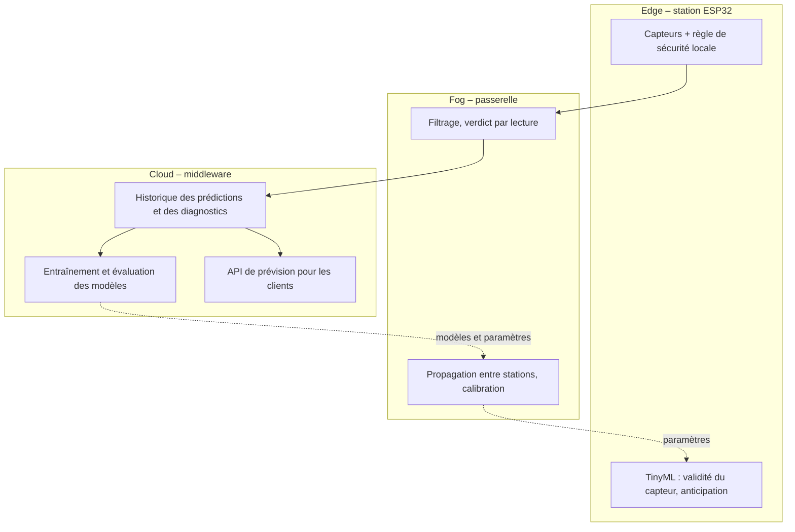

# Intelligence distribuée (edge – fog – cloud)

FloodWatch ne confie pas « le ML » à un modèle unique hébergé dans le Cloud. L'intelligence est
répartie sur les trois étages de l'infrastructure, chacun avec un rôle à sa mesure. Ce document
décrit le principe, **ce qui est en service aujourd'hui** et la feuille de route.

## 1. Principe : un rôle par étage

| Étage | Reste utile si… | Voit | Rôle |
|---|---|---|---|
| **Edge** – station ESP32 | tout le reste est injoignable | ses propres capteurs | valider ses lectures, anticiper localement (TinyML) |
| **Fog** – passerelle Raspberry Pi | l'accès Internet est coupé | toutes les stations d'une zone | propagation entre stations, calibration par station |
| **Cloud** – middleware WildFly | — | toute la flotte, la météo | entraînement, mesure des modèles, services aux clients |



Les traits pleins existent ; les pointillés sont la feuille de route (§ 4).

### Invariant de sécurité

À tous les étages, un modèle peut **avancer** une alerte, jamais la retarder ni l'annuler. Les
règles à seuil (station, passerelle, middleware) restent prioritaires, et une estimation ne
remplace jamais une mesure : un capteur aveugle déclenche un état dégradé, pas une valeur prédite.

## 2. Le modèle de référence

La prédiction en service est une régression linéaire sur 2 minutes, précédée d'un filtre médian
(`MedianFilterPredictor(LinearRegressionPredictor)`). Elle est conservée : c'est la **référence**
que tout nouveau modèle devra battre, à l'étage où il s'exécute.

Chaque prédicteur porte désormais une identité (`OverflowPredictor.modelId()`, ici
`median+linreg-120s`). Changer la fenêtre change le nom : deux réglages ne sont jamais confondus
dans les mesures.

## 3. Ce qui est en service : la fondation

Deux manques empêchaient tout travail sérieux sur des modèles. Ils sont comblés.

### 3.1 Historique des prédictions — mesurer avant d'améliorer

Jusqu'ici, rien ne gardait la trace d'une prédiction : impossible de dire si un modèle était bon,
encore moins s'il était meilleur qu'un autre.

1. **Enregistrement.** Toutes les 30 s et par station, le middleware note ce que le modèle
   annonce à 1, 3, 5 et 10 minutes (table `prediction_records`, statut `PENDING`).
2. **Évaluation.** Une tâche périodique (`PredictionScorer`, 30 s) confronte chaque prédiction
   échue à la mesure la plus proche de l'échéance (± 20 s) : statut `SCORED` et erreur signée
   *prévu − réel*. Sans mesure à l'échéance (station muette, capteur en défaut) : `MISSED`.
3. **Restitution.** `GET /api/kpi/predictions?hours=24` (opérateur) donne, par modèle et horizon :

| Champ | Lecture |
|---|---|
| `maeCm` | erreur absolue moyenne |
| `biasCm` | erreur signée moyenne : **négative = le modèle est en retard** sur la montée, positive = alarmiste |
| `rmseCm` | pénalise les grosses erreurs |
| `persistenceMaeCm` | erreur de la référence triviale « le niveau ne change pas » |
| `skill` | 1 − `maeCm` / `persistenceMaeCm` ; **≤ 0 : le modèle n'apporte rien à cet horizon** |
| `scored`, `missed` | taille de l'échantillon et prédictions non évaluables |

Ce service **observe** et ne décide de rien. Il écrit dans sa propre transaction : un incident
de son côté est journalisé sans jamais interrompre le traitement d'une mesure. Réglages :
`prediction.history.*` dans `microprofile-config.properties`.

### 3.2 Diagnostic du capteur — garder ce que la médiane efface

Le firmware prend la médiane de 5 échos et jetait le reste ; la passerelle écartait les échos
parasites sans rien en dire au Cloud. Les lectures douteuses, les plus instructives, ne laissaient
donc aucune trace. Le diagnostic traverse maintenant toute la chaîne **sur le topic `telemetry`
existant** (ni nouveau topic, ni nouvelle ACL) :

| Étage | Changement |
|---|---|
| Station (`firmware` 1.2) | publie `echoOk` (échos reçus sur 5) et `echoSpreadCm` (écart max − min) |
| Simulateur | produit les mêmes champs ; un écho parasite y a une salve moins complète et plus dispersée |
| Passerelle (Node-RED) | transmet le diagnostic ; une lecture écartée est jointe à la mesure suivante (`outliers`) |
| Middleware | historise **chaque** lecture dans `sensor_diagnostics` avec son verdict |

Verdicts : `ACCEPTED` (lecture retenue), `OUTLIER` (écho parasite écarté par la passerelle),
`FAULT` (capteur en défaut). Un saut de niveau confirmé par la lecture suivante n'est pas compté
comme parasite. `GET /api/kpi/sensors/{code}?hours=24` (opérateur) donne la répartition des
verdicts et la qualité moyenne des échos pour chacun.

Cette table sert deux fois : c'est l'**historique de santé** de chaque capteur, et un jeu
d'exemples **faiblement étiquetés** par le filtre de la passerelle, en complément des mesures de
banc pour le classifieur embarqué. Les champs sont facultatifs : un firmware 1.1 reste accepté.

### 3.3 Banc de mesure simulé — la simulation d'abord

Le matériel complet n'étant pas disponible, le projet avance **en simulation d'abord** : toute la
chaîne (mesure, détection de défaut, prédiction, décision) est développée et validée sur un
capteur simulé, avec des formats identiques à ceux du matériel pour que celui-ci s'y substitue
sans rien réécrire en aval.

Le capteur HC-SR04 est simulé **écho par écho** (`backend/simulator/fwsim/sensor.py`). Chaque lecture est
une salve de 5 échos, résumée par la même logique que le firmware (médiane, rejet sous 3 échos,
contrôle de plage) : `echoOk` et `echoSpreadCm` sont calculés, pas tirés au hasard. Chaque écho a
la résolution du firmware (durée en microsecondes entières, soit 0,017 cm) : une surface calme
peut donc donner une salve parfaite, et cela ne doit pas passer pour un défaut.

| Condition | Effet modélisé |
|---|---|
| `NORMAL` | bruit de quelques millimètres, écho perdu de temps en temps |
| `GLITCH` | écho parasite isolé : un objet traverse le faisceau le temps d'une lecture |
| `SPLASH` | éclaboussures : une partie des échos revient trop tôt, salve dispersée |
| `FOAM` | mousse : échos perdus, niveau surestimé de l'épaisseur de mousse |
| `OBSTRUCTED` | obstacle fixe dans le faisceau : niveau faussement haut |
| `STUCK` | capteur figé : la mesure ne suit plus le niveau, mais la salve garde un bruit ordinaire |
| `DRIFT` | dérive lente de la mesure |
| `DROPOUT` | capteur aveugle : presque aucun écho |

La station virtuelle agit désormais sur ce qu'elle **mesure**, comme le firmware, et non plus sur
le niveau réel : un capteur figé l'empêche réellement de fermer sa barrière. `SIM_FAULTS=random`
active des épisodes de défaut dans la pile Docker.

**Ce que la simulation apporte : la vérité terrain.** Le simulateur connaît le niveau réel et la
condition du capteur ; elle n'est jamais publiée, mais le banc l'écrit à côté de chaque lecture.
On mesure donc exactement ce qu'un détecteur attrape et ce qu'il laisse passer, ce qu'un banc
matériel ne permet pas sans instrumentation.

```bash
cd backend/simulator
python tools/sensor_bench.py --hours 24 --seed 1                                 # bilan
python tools/sensor_bench.py --hours 24 --out ../../ml/datasets/sensor_bench.csv # lectures étiquetées
python tools/sensor_bench.py --hours 24 --profile shifted                     # autres hypothèses
```

Chaque lecture reçoit une étiquette : `REJECTED` (le firmware l'écarte déjà), `GOOD`, `DEGRADED`
(capteur perturbé, valeur encore juste) et `BAD` — **retenue par le firmware mais fausse de plus
de 2 cm**, le cas dangereux, celui que le classifieur doit attraper.

**La référence à battre.** Sur 24 h simulées (graine 1, 17 280 lectures dont 1 423 `BAD`), la
règle « salve incomplète ou dispersion > 1 cm » donne :

| Hypothèses du capteur | Lectures fausses attrapées | Fausses alertes sur lectures saines |
|---|---|---|
| nominales | 64,5 % | 9,3 % |
| décalées (`--profile shifted`) | 42,2 % | 32,0 % |

Deux enseignements. D'abord, changer le seuil ne récupère rien (64,9 % à 0,5 cm, au prix de
20,1 % de fausses alertes ; 64,1 % à 2 cm) : un tiers des lectures fausses ont une **salve
d'apparence saine** — capteur figé (5 % attrapé), obstacle qui renvoie les 5 échos (58 %), écho
parasite complet (59 %). Aucun indicateur calculé
sur une seule salve ne peut les voir : il faut le **temps** (saut par rapport aux lectures
précédentes, variance nulle, niveau incohérent avec la pluie). C'est précisément là qu'un modèle
peut apporter ce qu'une règle ne donne pas. Ensuite, la règle se dégrade nettement quand le
capteur ne ressemble plus aux hypothèses : tout détecteur sera évalué sur les deux profils.

Ces chiffres valent pour le **modèle de capteur supposé**. Ils fixent une référence et une
méthode, pas une performance sur le terrain.

### 3.4 Classifieur embarqué de validité du capteur (TinyML)

Code : `ml/sensor_anomaly/` (indicateurs, entraînement, export) ; modèle exporté et rapport
complet : `ml/export/`. Réentraînement et critères : `python ml/sensor_anomaly/train.py`.

**Entrées.** Dix indicateurs que la station connaît, calculables sur l'ESP32 avec deux tampons de
6 lectures (`features.py`) : échos et dispersion de la salve courante, saut par rapport à la
médiane des 3 lectures précédentes, écart type et pente des 6 derniers niveaux, pluie courante et
moyenne, salves rejetées, dispersion et échos moyens récents. Aucune vérité terrain n'y entre.

**Protocole, fixé avant les résultats.** Apprentissage sur 6 journées simulées, choix du modèle
sur 2 autres, test sur une 7e jamais vue, puis sur la même journée avec le capteur **décalé**. Le
modèle retenu est celui qui attrape le plus de lectures fausses en validation sans dépasser le
taux de fausses alertes de la règle. Rien n'est réajusté pour le test.

**Résultats** (journée de test, lectures retenues par le firmware) :

| Modèle | Capteur nominal : attrapées | fausses alertes | Capteur décalé : attrapées | fausses alertes |
|---|---|---|---|---|
| Règle de référence | 68,6 % | 10,5 % | 45,8 % | 32,7 % |
| Arbre appris sur le capteur nominal | 95,5 % | 4,4 % | 88,8 % | **69,8 %** |
| **Arbre appris sur capteurs randomisés** (exporté) | **95,0 %** | **3,8 %** | **83,9 %** | **29,3 %** |
| Forêt de 10 arbres, capteurs randomisés | 95,1 % | 0,6 % | 79,3 % | 4,2 % |

Trois enseignements.

1. **Un modèle apprend aussi ses hypothèses.** Appris sur le seul capteur nominal, l'arbre est
   excellent sur ce capteur, puis signale 7 lectures saines sur 10 dès que le capteur est plus
   bruité : son entrée principale est la dispersion moyenne, et doubler le bruit pousse toutes
   les lectures saines au-delà de son seuil. Le test sur capteur décalé est ce qui l'a révélé.
2. **La randomisation de domaine** (chaque journée d'apprentissage a son propre capteur, tiré
   dans des plages qui excluent toutes les valeurs du profil décalé) ramène ces fausses alertes
   de 69,8 % à 29,3 %, sous celles de la règle, pour un demi-point de moins sur le capteur nominal
   (95,0 % au lieu de 95,5 %).
3. **Le capteur figé reste hors de portée** : environ 45 % attrapés. Sans connaître la réponse
   pluie → niveau du site, un niveau plat sous la pluie peut être un capteur figé ou un plateau
   d'équilibre. C'est exactement l'information que la calibration par la passerelle (phase 3)
   apportera.

**Modèle exporté.** Arbre de profondeur 4, 31 nœuds, environ 280 octets de code machine (gcc
`-Os`, x86-64 : ordre de grandeur, faute de chaîne Xtensa). Le C généré par emlearn est compilé
puis exécuté sur la journée de test : **il décide exactement comme Python** (100 %). Deux pièges
évités en route : emlearn convertit par défaut les entrées en entiers 16 bits (un seuil de
1,5 cm devenait 1), d'où `dtype="float"` ; et une forêt d'emlearn vote à la majorité alors que
scikit-learn moyenne des probabilités (0,74 % de décisions différentes), d'où la règle de vote
majoritaire appliquée partout, y compris pour choisir et évaluer.

**Critères d'acceptation** (`.github/workflows/ml.yml`, à chaque modification du banc ou du code
d'apprentissage) : battre la règle en lectures attrapées **et** ne pas la dépasser de plus d'un
point en fausses alertes, sur le capteur nominal comme sur le capteur décalé ; profondeur ≤ 8 ;
code compilé ≤ 16 Ko ; accord C/Python de 100 % ; et `ml/export/` identique à ce que le code
produit (versions des bibliothèques figées dans `ml/requirements.txt`).

**Ce qui n'est pas fait.** Le modèle n'est pas encore appelé par le firmware : il faut d'abord
porter `features.py` en C et décider de ce que fait la station d'une lecture jugée fausse (§ 6).
Il n'a pas été évalué à la cadence de 30 s du régime normal. Et ses chiffres valent pour le
capteur supposé, pas pour un HC-SR04 réel.

## 4. Feuille de route

| Phase | Contenu | État |
|---|---|---|
| 1. Fondation | historique des prédictions, diagnostic du capteur de bout en bout | **fait** |
| 1 ter. Banc simulé | capteur écho par écho, 8 conditions, lectures étiquetées, règle de référence mesurée | **fait** |
| 1 bis. État dégradé | règle déterministe de la station quand le capteur est aveugle (voir § 6) | à décider |
| 2. TinyML à l'edge | classifieur de validité du capteur, entraîné sur le banc simulé, exporté en C (emlearn), chaîne ML en CI | **fait** (intégration au firmware à faire) |
| 3. Fog | topologie amont/aval, propagation entre stations, calibration par station | à faire |
| 4. Service client | API de prévision multi-horizon pour des clients tiers à portée limitée | à faire |

**Phase 2 – TinyML (suite).** Le modèle (§ 3.4) doit encore s'insérer dans `measure()` du
firmware, avant que la règle de sécurité locale ne consomme la lecture. Pour que la simulation
exécute le **même code** que l'ESP32, la logique embarquée (indicateurs, modèle, règle locale)
sera isolée dans une bibliothèque C++ sans dépendance Arduino, compilée pour l'ESP32 et pour le
poste de travail. L'anticipation locale du niveau est une seconde expérience, à comparer à une
régression linéaire embarquée.

**Phase 3 – Fog.** La passerelle raisonne aujourd'hui station par station alors qu'elle seule
voit toute une zone et survit à une coupure Internet. Elle recevra : un lien amont → aval dans
`stations.json` et une pré-alerte de la station aval (règle d'abord, modèle ensuite) ; l'estimation
de la réponse pluie → niveau de chaque site, renvoyée à la station par le topic `config`. Le
simulateur devra coupler ses stations : aujourd'hui elles sont indépendantes.

**Phase 4 – Service client.** Trois prérequis manquent dans le code : les entités `Tenant` et
`Grant` ne sont pas persistées et rien ne les utilise ; le jeton ne porte ni portée ni client ;
`Station` n'a ni zone ni propriétaire côté Cloud.

## 5. Limites assumées

- **Données simulées.** Tant que les mesures viennent du simulateur, un modèle de prévision
  apprend son équation (`dL/dt = a·pluie − b·L`) et un détecteur de défaut apprend le modèle de
  capteur du § 3.3. Cela démontre la chaîne et la méthode, pas l'hydrologie ni le HC-SR04 réel.
  Garde-fous : hypothèses écrites et paramétrées (`SensorPhysics`), évaluation systématique sur
  un second jeu d'hypothèses, hydrologie tirée au hasard à chaque épisode, et un format de
  lecture qu'un banc réel pourra alimenter tel quel (`summarize()` prend des échos mesurés).
- **Scores, pas probabilités.** Une sortie de modèle ne s'appelle « probabilité » qu'une fois
  calibrée sur de vrais épisodes.
- **Mise à jour des modèles embarqués.** Un modèle compilé dans le firmware se met à jour par
  reflashage : il n'y a pas d'OTA. Seuls des paramètres passent par MQTT.
- **Risque d'itinéraire.** Sans réseau routier, le service réaliste note les stations d'un
  couloir autour d'un tracé fourni par le client, pas un trajet origine → destination.
- **Volume.** Ni `prediction_records` ni `sensor_diagnostics` ne sont purgées (comme
  `measurements`) : environ 11 500 et 17 000 lignes par station et par jour en surveillance
  renforcée. Une rétention sera à prévoir avant un déploiement long.

## 6. Décisions ouvertes

1. **État dégradé de la station.** Aujourd'hui `localSafetyRule()` ne fait rien si le capteur est
   en défaut. Capteur aveugle et pluie soutenue : simple avertissement (feu orange) ou fermeture
   de précaution ? C'est un choix d'exploitation, à trancher avant de l'écrire.
2. **Recalage sur matériel.** Tranché : simulation d'abord (§ 3.3). Dès qu'un ESP32 et un
   HC-SR04 seront disponibles, quelques séries réelles (capteur dégagé, obstrué, mousse,
   éclaboussures) serviront à recaler `SensorPhysics` et à mesurer l'écart simulation → réel.
3. **OTA.** À ajouter si l'on veut mettre à jour un modèle embarqué sans intervention sur site.
4. **Arbre ou forêt.** Le critère de choix, fixé avant les résultats, classe d'abord sur les
   lectures fausses attrapées ; la comparaison entre arbre et forêt lui a été ajoutée après une
   première exécution. Il retient l'arbre (82,8 % contre 82,3 % en validation). Mais la
   forêt fait 4 fois moins de fausses alertes en validation (0,6 % contre 2,7 %) et 7 fois moins
   sur le capteur décalé (4,2 % contre 29,3 %), pour environ 4,7 Ko de code. Combien de fausses
   alertes vaut une lecture fausse manquée est un choix d'exploitation : une fois tranché, il
   s'écrit dans le critère de choix et le modèle est réentraîné, sans retoucher aux tests.
